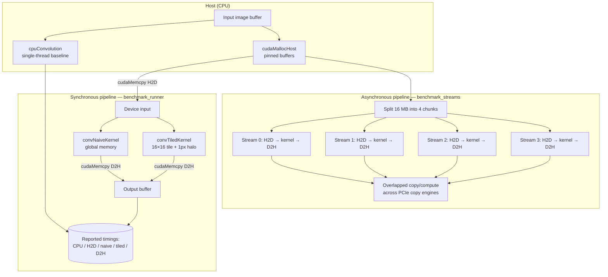
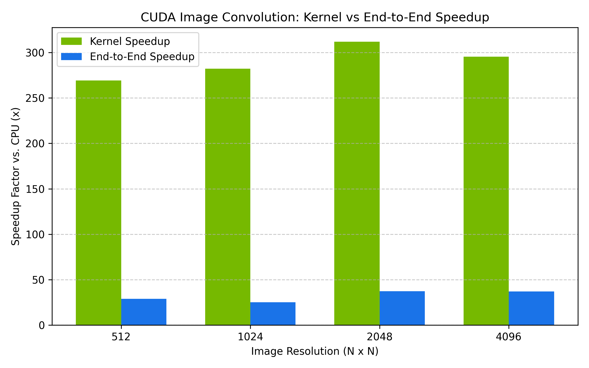

# CUDA Image Processing Accelerator

**CPU vs. GPU performance engineering for 2D spatial image filters**

A compact C++/CUDA project that implements RGB-to-grayscale conversion and a 3×3 convolution filter, then benchmarks naive global-memory, shared-memory-tiled, and asynchronous multi-stream GPU pipelines against a single-threaded CPU reference. The goal is not just raw speed, but to *explain where the time goes* — kernel compute vs. PCIe transfers vs. memory-access patterns.

---

## Highlights

- **Peak kernel speedup:** **311.9×** over the CPU reference (2048×2048, tiled kernel).
- **End-to-end speedup:** **37.2×** including PCIe transfers at the same resolution.
- **PCIe bottleneck quantified:** at 4096×4096, transfers consume **7.655 ms of 8.751 ms (~87.5%)** of the synchronous pipeline.
- **Shared-memory tiling:** ~73% lower kernel latency than naive global access at 512×512 — and a measured *regression* at larger sizes, explained by L1 caching and synchronization overhead.
- **Stream pipelining:** pinned host memory + 4 CUDA streams overlap H2D copy, compute, and D2H copy.
- **Verified correctness:** GPU grayscale output matches the CPU reference within a ±1 tolerance.
- **Profiled** with NVIDIA Nsight Compute (`ncu`).

---

## Objectives

1. Implement a numerically correct CPU reference for spatial filtering (clamp-to-edge boundary handling).
2. Port the filter to CUDA with two memory strategies: direct global access and shared-memory tiling with halo loading.
3. Measure kernel time and transfer time independently using CUDA events.
4. Apply Amdahl's Law reasoning to identify the real bottleneck (PCIe, not compute).
5. Mitigate that bottleneck with asynchronous, page-locked, multi-stream transfers.

---

## Tech Stack

| Category | Technology |
| --- | --- |
| Language | CUDA C++, C++17 |
| Parallel model | CUDA kernels, shared memory, streams, pinned memory, CUDA events |
| Build | CMake 3.18+, `find_package(CUDAToolkit)` |
| Reference CPU | Single-threaded C++ with `std::chrono` timing |
| Profiling | NVIDIA Nsight Compute (`ncu`), NVIDIA Nsight Systems (`nsys`) optional |
| Compiler | GCC 13, NVCC (CUDA 12.x) |
| Target GPU | NVIDIA Tesla T4 (Turing, compute capability 7.5) — build uses `-arch=native` |

---

## Repository Structure

```
cuda-image-accelerator/
├── CMakeLists.txt                  # Build targets: library + 3 executables
├── include/
│   ├── common.hpp                  # CUDA_CHECK macro, tile/filter constants, launch APIs
│   └── cpu_reference.hpp           # CPU grayscale + convolution declarations
├── src/
│   ├── cpu_reference.cpp           # Single-threaded baseline with clamp-to-edge
│   ├── grayscale.cu                # RGB → grayscale kernel (Rec. 601 luma)
│   ├── convolution_naive.cu        # Direct global-memory 3×3 convolution
│   └── convolution_tiled.cu        # Shared-memory tiled convolution with halo cells
├── benchmarks/
│   ├── benchmark.cpp               # CPU vs naive vs tiled scaling (512 → 4096)
│   └── benchmark_streams.cu        # Async pinned-memory multi-stream pipeline
├── tests/
│   └── correctness_tests.cpp       # GPU vs CPU grayscale tolerance check
├── speedup_scaling.png             # Speedup across resolutions
├── speedup_comparison.png          # Kernel vs end-to-end comparison
└── README.md
```

---

## Architecture & Data Flow



---

## Implementation Details

### 1. CPU reference (`cpu_reference.cpp`)
A straightforward single-threaded convolution over a grayscale buffer. Boundary pixels use **clamp-to-edge** addressing so output dimensions match input dimensions. Timing uses `std::chrono::high_resolution_clock`.

### 2. RGB → grayscale (`grayscale.cu`)
One thread per output pixel, applying the Rec. 601 luma weights:

```
gray = 0.299*R + 0.587*G + 0.114*B
```

Verified against the CPU version with a deterministic `std::mt19937` input (seed 42), `max_diff <= 1`.

### 3. Naive convolution (`convolution_naive.cu`)
Each thread loads all 9 filter taps directly from global memory. Neighbour coordinates are clamped to `[0, width-1] × [0, height-1]`. `__restrict__` pointers help the compiler avoid alias assumptions. Simple, but performs redundant global loads for overlapping 3×3 neighbourhoods.

### 4. Shared-memory tiled convolution (`convolution_tiled.cu`)
A 16×16 thread block loads a **18×18 tile** into `__shared__` memory: 16×16 interior plus a 1-pixel halo on each edge. Halo loads are split into interior, edge, and corner cases to avoid duplicate stores, followed by a single `__syncthreads()`. Each thread then reads its 3×3 neighbourhood from shared memory. Clamp-to-edge is applied on load, preserving CPU-equivalent output.

### 5. Asynchronous stream pipeline (`benchmark_streams.cu`)
- Host buffers allocated with `cudaMallocHost` (page-locked, so DMA can proceed asynchronously).
- A 4096×4096 (16 MB) image is split into 4 horizontal chunks.
- For each chunk, on its own `cudaStream_t`: `cudaMemcpyAsync(H2D)` → `convNaiveKernel<<<..., stream>>>` → `cudaMemcpyAsync(D2H)`.
- A warm-up run removes first-launch/driver overhead before `cudaEvent` timing.

---

## Benchmark Results

Measured with CUDA events (microsecond precision) on the target GPU. Speedups are `CPU time / tiled kernel time` and `CPU time / (H2D + tiled + D2H)`.

| Resolution | CPU (ms) | H→D (ms) | Naive (ms) | Tiled (ms) | D→H (ms) | Kernel speedup | End-to-end speedup |
|:---:|:---:|:---:|:---:|:---:|:---:|:---:|:---:|
| 512 × 512 | 5.75 | 0.089 | 0.079 | 0.021 | 0.089 | **269.3×** | **28.9×** |
| 1024 × 1024 | 20.23 | 0.400 | 0.066 | 0.072 | 0.334 | **282.2×** | **25.1×** |
| 2048 × 2048 | 86.78 | 1.025 | 0.255 | 0.278 | 1.027 | **311.9×** | **37.2×** |
| 4096 × 4096 | 323.75 | 3.802 | 0.979 | 1.096 | 3.853 | **295.5×** | **37.0×** |

### Visual comparisons




---

## Key Findings

### 1. Tiling helps small images, hurts large ones
At 512×512 the tiled kernel cut kernel latency from 0.079 ms to 0.021 ms (**~73% reduction**) by keeping neighbourhoods in shared memory. From 1024×1024 upward, naive global access was slightly *faster* (0.979 ms vs 1.096 ms at 4K).

**Why:** Turing's unified L1/texture cache already serves overlapping warp reads at very high hit rates for a compact 3×3 stencil. The tiled kernel additionally pays for halo-load branch divergence and `__syncthreads()` barriers. On this hardware, those costs outweigh the shared-memory savings once the working set is large enough for the cache to work well. This is a deliberate, measured finding — not an assumption that "shared memory is always faster."

### 2. PCIe, not compute, is the bottleneck (Amdahl's Law)
At 4096×4096 the tiled kernel runs in **1.096 ms**, but the two transfers take **3.802 + 3.853 = 7.655 ms** — **~87.5%** of the 8.751 ms synchronous pipeline. That is why a **~295×** compute speedup becomes only **~37×** end-to-end.

### 3. Stream overlap attacks the real bottleneck
Splitting the buffer across 4 pinned-memory streams lets copy engines and SMs work concurrently, hiding transfer latency behind compute. Run `benchmark_streams` on your GPU to observe the improvement for your PCIe topology.

---

## Build & Run

### Prerequisites
- NVIDIA GPU with CUDA-capable driver
- CUDA Toolkit 12.x (`nvcc` on `PATH`)
- CMake ≥ 3.18, a C++17 compiler (GCC 13 used here)
- Linux/WSL (PowerShell equivalents noted below)

```bash
git clone https://github.com/pravalika123-tech/Cuda-Image-Accerlator.git
cd Cuda-Image-Accerlator
mkdir -p build && cd build
cmake .. -DCMAKE_BUILD_TYPE=Release
cmake --build . -j$(nproc)      # Windows: cmake --build . --config Release
```

Three executables are produced:

```bash
./correctness_tests    # GPU vs CPU grayscale tolerance check
./benchmark_runner     # CPU/naive/tiled scaling table
./benchmark_streams    # async 4-stream pipeline (4096×4096)
```

On Windows, the binaries are under `build\Release\` (or `build\` for single-config generators).

### Sample output (benchmark_runner)

```
Size     CPU (ms)    HtoD (ms)   Naive (ms)    Tiled (ms)   DtoH (ms)    Speedup(K)    Speedup(E2E)
--------------------------------------------------------------------------------------------------
512      5.75        0.089       0.079         0.021        0.089        269.3         28.9
1024     20.23       0.400       0.066         0.072        0.334        282.2         25.1
2048     86.78       1.025       0.255         0.278        1.027        311.9         37.2
4096     323.75      3.802       0.979         1.096        3.853        295.5         37.0
```

Correctness check:

```
[Test: Grayscale] Max difference: 0 or 1 -> PASSED
```

---

## Profiling

The kernel design decisions were validated with Nsight Compute:

```bash
ncu --set full ./benchmark_runner
```

Metrics of interest: shared-memory bank conflicts, L1/L2 hit rate, achieved occupancy, and DRAM throughput. Use Nsight Systems to visualize stream overlap:

```bash
nsys profile --stats=true ./benchmark_streams
```

---

## Resume bullet points

- Implemented CUDA C++ image-processing kernels (grayscale conversion, naive and shared-memory-tiled 3×3 convolution) and validated output against a CPU reference with ±1 tolerance.
- Benchmarked across 512–4096px resolutions with CUDA events, achieving up to **311× kernel speedup** and **37× end-to-end speedup** over single-threaded C++.
- Profiled PCIe transfer overhead with Nsight Compute, identifying transfers as **~87%** of 4K pipeline time and mitigating it with pinned-memory, 4-stream asynchronous copy/compute overlap.

---

## Hardware & environment used for reported numbers

- **GPU:** NVIDIA Tesla T4 (Turing, CC 7.5)
- **Toolchain:** CUDA 12.x, GCC 13, CMake 3.31
- **Build:** `-DCMAKE_BUILD_TYPE=Release`, `-DCMAKE_CUDA_ARCHITECTURES=native`

Numbers will vary on different GPUs and PCIe generations; the relative trends (tiling crossover, transfer dominance) are the reproducible finding.
