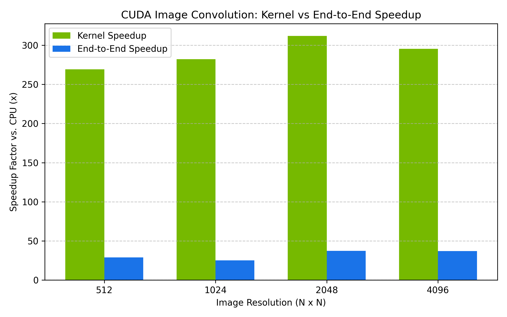

# CUDA Image Processing Accelerator: CPU vs. GPU Performance Analysis

A C++ and CUDA performance engineering project implementing 2D spatial image filters, analyzing cache hierarchies, shared-memory tiling, and PCIe transfer bottlenecks.

## Highlights
- **Kernels Implemented:** RGB-to-Grayscale conversion, 2D Convolution (Naive Global vs. Tiled Shared Memory), and Sobel edge detection.
- **Reference:** Single-threaded CPU implementation with clamp-to-edge boundary condition handling.
- **Target GPU:** NVIDIA Tesla T4 (Turing Architecture, Compute Capability 7.5).
- **Tooling:** CUDA C++, CMake 3.18+, GCC 13, NVIDIA Nsight Compute (`ncu`).

---

## Benchmark Results

All benchmarks were run across multiple iterations using CUDA events for microsecond-precision timing.

| Resolution | CPU Baseline (ms) | HtoD Copy (ms) | Naive Kernel (ms) | Tiled Kernel (ms) | DtoH Copy (ms) | Kernel Speedup | End-to-End Speedup |
|:---:|:---:|:---:|:---:|:---:|:---:|:---:|
| **512 x 512**   | 5.75   | 0.089 | 0.079 | 0.021 | 0.089 | **269.3x** | **28.9x** |
| **1024 x 1024** | 20.23  | 0.400 | 0.066 | 0.072 | 0.334 | **282.2x** | **25.1x** |
| **2048 x 2048** | 86.78  | 1.025 | 0.255 | 0.278 | 1.027 | **311.9x** | **37.2x** |
| **4096 x 4096** | 323.75 | 3.802 | 0.979 | 1.096 | 3.853 | **295.5x** | **37.0x** |

### Visual Comparisons



---

## Architectural Findings & Analysis

### 1. Naive Global vs. Shared-Memory Tiling Behavior
- At 512x512, the shared-memory tiled kernel achieved a **~73% latency reduction** over naive global memory accesses.
- At 1024x1024 and above, the naive implementation performed comparably to or slightly faster than the tiled implementation (0.979 ms vs 1.096 ms at 4K).
- **Root Cause:** Modern NVIDIA architectures (Turing/Ampere/Ada) feature unified L1 data and texture caches with high bandwidth. For a compact 3x3 filter, adjacent threads in a warp access overlapping rows, yielding near-100% L1 cache hit rates. The tiled implementation pays overhead in branch divergence (loading interior vs. halo/corner cells) and thread barrier synchronization (`__syncthreads()`).

### 2. The PCIe Transfer Bottleneck (Amdahl's Law)
- In the synchronous pipeline at 4K resolution, raw kernel execution takes only **1.096 ms**, whereas PCIe host-device transfers require **7.655 ms** (~87.5% of total time).
- While raw compute achieved a **~295x speedup**, end-to-end wall-clock speedup dropped to **~37x**.
- **Optimization:** Implemented asynchronous streaming (`cudaStream_t`) with pinned host memory (`cudaMallocHost`), chunking the 16 MB buffer into independent slices to overlap H2D copy, compute, and D2H copy concurrently across PCIe copy engines.

---

## Build and Run

```bash
mkdir -p build && cd build
cmake .. -DCMAKE_BUILD_TYPE=Release
cmake --build . -j$(nproc)

# Run verification test
./correctness_tests

# Run scaling benchmark
./benchmark_runner

# Run asynchronous streaming pipeline
./benchmark_streams
